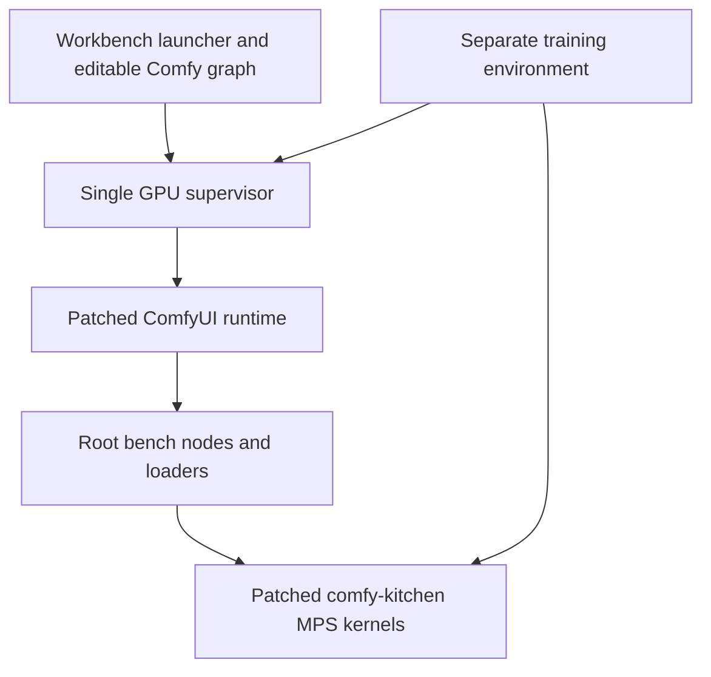

# Understanding and changing this stack

Start with the [user guides](docs/README.md). This is a personal, pre-production Apple GPU integration stack, qualified on an M1 Max with 32 GB shared memory. A supported recipe means the dated receipt records a completed render and inspection at that scope. A CPU contract test, successful registration or historical larger render establishes something narrower.

## Ownership and execution



| Surface | Canonical source and responsibility |
| --- | --- |
| Operator UI | `*.command` launchers and the linked workbench guides. Qwen's thin launcher reuses the native Video server; Krea uses its dedicated bounded graph/API server. |
| Comfy integration | [serve.sh](bench/serve.sh), [setup_custom_nodes.py](bench/setup_custom_nodes.py), [video node package](bench/video_nodes/__init__.py) and family-specific modules. Qwen nodes are also registered here. These select assets, prepare conditioning and call the runtime. |
| Native model lifecycle | `vendor/ComfyUI`: independent patched Git checkout. Loader dispatch, quantized model handling, patch restoration and offload belong here. |
| Native kernels | `vendor/comfy-kitchen/comfy_kitchen/backends/mps/`: independent patched checkout. Linear/attention/autograd and packed-format implementations belong here. Root `.metal` benchmarks are experiments, not automatically production kernels. |
| GGUF | Independent `vendor/ck-gguf` Kitchen checkout and `vendor/ComfyUI-GGUF-fork` custom-node checkout; keep their changes separate from the active native Kitchen runtime. |
| Training and export | [training guide](docs/how-to-train.md) and [Krea export guide](docs/how-to-krea-workbench.md). Quantization/export is CPU work; distilling RAW into Turbo is a different training project. |
| Assets and evidence | `MK_ROOT` selects storage, normally an external SSD (default `~/mac-kernels-data`). Model bytes, conditioning caches, latents, renders and large receipts are separate from tracked code. Never mutate a mapped checkpoint. |

A root clone is **not a complete runtime installation**. `vendor/`, both virtual environments and model assets are ignored, and there are no Git submodules or universal bootstrap script. Root commits do not preserve vendor edits. Inspect and preserve each nested repository independently. [Upstream preparation](docs/upstream/README.md) describes historical submission branches, not a replacement for the integrated runtime.

Installed native snapshot, October 8, 2026 (recorded for reconstruction, not a universal package recommendation):

| Checkout | Branch | Commit | Fork or upstream |
| --- | --- | --- | --- |
| `vendor/ComfyUI` | `mps-int8-weight-only` | `e11d9226193299e5a55529c60fecdefd482191b5` | [roblennon/ComfyUI](https://github.com/roblennon/ComfyUI) |
| `vendor/comfy-kitchen` | `mps-weight-only-backend` | `9825e98990cfa278c033482e94275206f2b01ea7` | [roblennon/comfy-kitchen](https://github.com/roblennon/comfy-kitchen) |
| `vendor/ck-gguf` | `mps-gguf` | `da65b2060536f7d618db7e0a91e42aee59ea5e82` | [roblennon/comfy-kitchen](https://github.com/roblennon/comfy-kitchen) |
| `vendor/ComfyUI-GGUF-fork` | `mps-gguf-kernel` | `bef90ac575b0f89cb56e4dcc012295412c2b2f6a` | not public |

Native `.venv` currently uses Python 3.12.11, Torch 2.14.1, safetensors 0.8.0, transformers 5.18.0 and Comfy frontend 1.53.10. Kitchen is path-linked to its active vendor checkout. Root has no complete dependency lock; the trainer has its own [lock](train/requirements.lock.txt). MLX is not installed in the native environment. Spectral and Krea2Edit are source/hash-admitted dependencies governed by [spectral_krea.py](bench/spectral_krea.py) and [krea_reference.py](bench/krea_reference.py); a directory under `vendor/` need not be a Git repository. Spectral preflight can acquire its pinned helper when absent. Fork access and separately acquired licensed assets are prerequisites for another user's reconstruction; this is not yet a public turnkey distribution.

## Shared contracts

[Krea read-only loading](bench/krea_readonly.py) is also used by WAN, H3 and Qwen. Its mapped source ownership and bounded residency are shared mechanisms despite the filename. [Streamed adapter sides](bench/krea_adapter.py) avoid dense merges for admitted packed targets. Each family owns source/header admission, block matching, dtype and release; H3 ordinary BF16 refiner targets retain the vendor dense path.

Resident caps (currently Krea/WAN14/H3 1 GiB, Qwen 4 GiB in their documented paths) bound resident weights, **not** activations, temporary factors, driver allocations or total process memory. One memory policy supervises all these workloads. Warning pressure can continue; critical/resource stops remain. A smaller graph can still fail during loading. Do not increase guard limits to hide a lifecycle bug.

Only one GPU owner runs at a time. Temporary global hooks must restore in `finally`; mapped tensors and checkpoint bytes remain immutable for their entire lifetime. Conditioning workers must release the encoder before diffusion admission. Checkpoint/adapter switching must restore the base; export must preserve source identities and verify published bytes. Saved WAN latents are sampling outputs: draft/final change only decoding, never secretly resample.

## Generated workflows

| Source to edit | Derived artifacts | Contract tests |
| --- | --- | --- |
| [krea_workflows.py](bench/krea_workflows.py) | Krea UI JSON and API pairs in `bench/workflows/` | [Krea](tests/test_krea_workflows.py) |
| [video_workflows.py](bench/video_workflows.py) | WAN/H3 UI JSON and API pairs (portrait defaults), including the WAN14/H3 image-to-video graphs | [Video](tests/test_video_workflows.py) |
| [qwen_workflows.py](bench/qwen_workflows.py) | Qwen UI JSON and API pair | [Qwen](tests/test_qwen_workflows.py) |

These generators share [workflow_canvas.py](bench/workflow_canvas.py); Qwen also reuses the accepted template builder and video node schemas. Change the generator, regenerate with its `--output-dir` into temporary storage, compare against tracked artifacts, then update both JSON forms deliberately. Hand-editing only the exported graph creates drift. A user's saved canvas is personal state, not generator source.

## Acquiring and converting weights

Downloads are hash-verified against their source's own metadata and leave a manifest beside the files: [hf_prepare.py](bench/hf_prepare.py) (pinned Hugging Face files, by Hub revision) and [prepare_wan_i2v.py](bench/prepare_wan_i2v.py) (WAN A14B I2V fp16 experts and the Lightning I2V pair). [wan_int8_convert.py](bench/wan_int8_convert.py) turns a Comfy-layout fp16 WAN expert into the INT8 ConvRot layout by mirroring an installed expert key for key, as [qwen_int8_convert.py](bench/qwen_int8_convert.py) does for Qwen; the converted header hash must then be recorded in [wan_memory.py](bench/wan_memory.py) before the bounded loader admits the file. [lora_header_report.py](bench/lora_header_report.py) summarizes an adapter's naming family, ranks, alpha and targets from the header alone; run it before any admission decision. Everything lands under `$MK_ROOT/models`; internal storage stays out of it.

## Run the tests

From the repository root, with the native `.venv` active:

```bash
bench/with_gpu.sh .venv/bin/python -m pytest tests -q -p no:cacheprovider --ignore=tests/test_gguf_node.py
PYTHONPATH=vendor/ck-gguf bench/with_gpu.sh .venv/bin/python -m pytest tests/test_gguf_node.py -q -p no:cacheprovider
```

`bench/with_gpu.sh` serializes anything that touches the GPU, so tests never overlap a render or a training run. The GGUF node tests run separately because they need the `mps-gguf` Kitchen checkout on the path in place of the active one.

The kernel numerics live in the vendor checkouts, not in `tests/`. Most skip themselves when the mps backend is unavailable; `test_mps_attention_backward.py` falls back to CPU instead. They test whatever commit the vendor checkout holds, which can differ from the October 8 snapshot in the table above, so record `git -C vendor/comfy-kitchen rev-parse HEAD` with the result. Run them the same way, from the repository root:

```bash
bench/with_gpu.sh .venv/bin/python -m pytest vendor/comfy-kitchen/tests/test_mps_int8_linear.py vendor/comfy-kitchen/tests/test_mps_w4a8.py vendor/comfy-kitchen/tests/test_mps_block_formats.py vendor/comfy-kitchen/tests/test_mps_gguf.py vendor/comfy-kitchen/tests/test_mps_autograd.py vendor/comfy-kitchen/tests/test_mps_packed_autograd.py vendor/comfy-kitchen/tests/test_mps_attention_backward.py -q -p no:cacheprovider
PYTHONPATH=vendor/ck-gguf bench/with_gpu.sh .venv/bin/python -m pytest vendor/ck-gguf/tests/test_mps_gguf.py -q -p no:cacheprovider
```

`test_mps_int8_linear.py` checks the INT8 linear against a float64 CPU linear over the dequantized weight. `test_mps_w4a8.py` and `test_mps_block_formats.py` check the W4A8/W6A8 and NVFP4/MXFP8/W4A4 decodes and linears against eager on CPU. `test_mps_gguf.py` checks the GGUF decode bit for bit against the `gguf` package. `test_mps_autograd.py`, `test_mps_packed_autograd.py` and `test_mps_attention_backward.py` check the backward paths against CPU fp32 or float64 oracles. `test_mps_linear_lifetime.py` is a CPU regression for the chunk driver's tensor lifetimes, and `test_mps_empty_linear.py` covers empty contractions; neither is a numerics check.

Without `vendor/ComfyUI` (a fresh clone), [tests/conftest.py](tests/conftest.py) skips the test files that need the patched runtime and says so in the pytest header (visible without `-q`). The remaining CPU contracts still run, but the skipped files hold the real-runtime contracts, so treat a vendor-less run as a smoke check, not a pass.

## Verification by boundary

| Change | Evidence to use |
| --- | --- |
| Workflow/control schema | Generator tests above; import/registration does not qualify sampling. |
| Mapped ownership and adapter routing | [WAN](tests/test_wan_memory.py), [H3](tests/test_h3_memory.py), plus family loader tests. Exercise actual patch/load control flow, unrelated-model pass-through and hook restoration. |
| Training configuration/recovery | [Configuration](tests/test_training_config.py), [buckets](tests/test_training_buckets.py), [recovery](tests/test_training_recovery.py), [identity](tests/test_training_identity.py), [preview](tests/test_training_preview.py). |
| Packed backward | [Trainer routing](tests/test_training_packed.py), [artifact boundary](tests/test_packed_training_artifact.py); vendor MPS autograd tests for real GPU gradients. CPU fixtures do not establish GPU numerical correctness. |
| Export/publication | [Export](tests/test_krea_export.py), [jobs](tests/test_krea_export_jobs.py), [release](tests/test_krea_export_release.py): math, provenance, cancellation, installation and mapped release. |
| Evaluation | [Column separation](tests/test_eval_lora_columns.py); one guarded final image per process, then inspect finite pixels and compose comparisons. |

Use focused CPU checks first. GPU tests/renders require the serialized monitored runner, current guard and a bounded recipe; record source, assets, dimensions, schedule, elapsed time, peak memory and inspected output. Preserve refusals. Prefer existing matched outputs over rerunning a matrix. Keep the normal [.repo-check](.repo-check) pre-push suites. Update the relevant guide and dated receipt when behavior changes.
